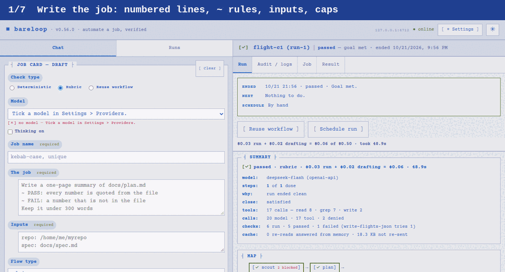

```
                    ╭──────────────────────────────────────╮
                    │  ╔╗ ╔═╗╦═╗╔═╗╦  ╔═╗╔═╗╔═╗            │
                    │  ╠╩╗╠═╣╠╦╝╠╣ ║  ║ ║║ ║╠═╝            │
                    │  ╚═╝╩ ╩╩╚═╚═╝╩═╝╚═╝╚═╝╩              │
                    │    run ──→ verdict ──→ inherit       │
                    │     ↑                     │          │
                    │     └─────────────────────┘          │
                    ╰──╮───────────────────────────────────╯
                       ╰── workflows that earn their own design
```

<p align="center">
  
  
  
</p>

**"Automate this job — I don't know the best workflow."**

Hire an agent for a job, not a task. You sign the scope, it works inside a hard budget and time, and code checks the result before you accept it.

The best workflow is the shortest proven path that gets the job done, and that heals itself when a different model works a different way.

bareloop finds that path for you. Write your problem in plain language, as steps. Under each step, say what counts as success and what it must never do. The agent builds the bridge it will walk on, and the run is green only when the output passes checks the agent never touches.

The harness (budget, time, what it may touch) and the judge both sit **outside** the agent loop. The agent can't judge itself. Every run is recorded, so you can audit it and replay it at $0 and see exactly what happened.

<p align="center">
  
</p>

## The factory that builds the factory

Software factories run a flow someone wrote in advance. bareloop builds the flow for each job, then lets a gauge it can't touch decide if the work is good. Trust needs four things. Miss one and trust is zero. bareloop has all four.

**Intent.** You write the job as plain numbered steps, and a `~` line under each says what success means and what it must never do. Every step gets a check or a written reason why not. You sign before a dollar is spent.

**Guide rails, not just guardrails.** Guardrails stop the agent going off the road: a money cap, a time cap, and a read/write fence it can't move. Guide rails keep it on the road: each new worker hears what earlier tries read, searched and changed, diffs included; two misses redraw the plan; past lessons go to the planner; an unclear job gets up to 3 questions, not a guess.

**Verification.** The check sits outside the agent's loop: code decides, not an AI judge. Anything code can't check is listed as Not checked, and you judge it at Accept. A red goes back with the real error to be fixed, until it's green or out of budget.

**Evidence.** Every call, every allowed or blocked read and write, every check result and every cent is recorded. You can audit it in the panel and replay it at $0. Research facts are quoted from saved sources.

## Two kinds of jobs

**Deterministic (code)**: code decides. Tests pass, the linter is quiet, the build exits clean. The agent picks its checks from a fixed set of check types it can't extend; whatever none of them can check is listed as Not checked.
> *"Fix the lint errors."* · *"Add doc comments to every function."* · *"Split this 3,000-line file without breaking a test."*

**Rubric (research, sheets and lists)**: it reads the pages, files and sheets you give it and hands you a report. Every fact is quoted from its saved source, and code works out sheet totals and checks each list item's form. An AI only points; code decides. What code can't check is listed as Not checked, for you at Accept.
> *"Find flights LAX→SFO under $400, nonstop, no red-eye."* · *"Total the expenses over $500 in this sheet."* · *"List every item in this tracker: a title, a status, a summary under 200 characters."*

## What it won't do

bareloop reads and writes. It never acts on the world: no paying, booking, sending forms or posting. When a job needs a person partway through, or needs to *do* something, like book the flight bareloop found, that's **[fwdloop](https://npmjs.com/package/fwdloop)**.

**Small tools, all local.** Built on the bare suite (bareagent, bareguard, litectx, barebrowse), always LLM-agnostic, always on your machine, with a simple panel UI.

## You have the last word

Every judged run ends at a **review door** (a purely mechanical green finishes on its own —
ask for the door with `--review-door`): here is what changed, here is what every check said,
here is what I'm asking you. **Accept** it, **rerun** it — what you type is the feedback the next
attempt works from (the money already spent still counts against your cap; the time is fresh) — or **pause** it and decide another day. A pause costs
nothing, keeps everything, and picks up from the start of the last step whenever you come back.
Never come back, and it quietly expires on its own.

The door never rewrites the run's own verdict. A green stays green in the record whatever you
decide about it; your answer says what happens to the work, not what the work scored.

## Why the agent authors the workflow

The bare suite gave us forty-plus primitives, and there are at least as many opinions about
how context engineering should be broken into steps. Instead of picking one opinion and
shipping it as the recipe, bareloop makes the agent the author. It chooses its own path
through the primitives and then has to survive verification it cannot edit, widen, or
disable.

The lessons from ralph, RLMs, and code machine MCP are in here, applied to the small parts
rather than adopted whole. None of them is the workflow; each one is available to the agent
building it.

## Install

```bash
npm install bareloop
```

Quick start: `npm install -g bareloop`, then `bareloop` — a menu to start the panel, stop it, see its status, and set up `~/.config/bareloop/`.

## Usage

A signed job spec goes in. A verdict comes out.

```js
import { runJob, jobSpecHash, makeSpine } from 'bareloop';
import { AnthropicProvider } from 'bare-agent/providers';

const spec = {
  schema: 'job-v1',
  job: 'my-maintainer',
  description: 'fix src until the suite greens',
  goal: 'Fix any failure in src/ so the suite passes.',
  verdictType: 'green',
  close: [{ name: 'suite-green', cmd: 'npm test', expect: 0 }],
  provider: 'anthropic-api',
  cadence: { unit: 'day', every: 1 },
  budgetUsd: 1.5,
  writeScope: ['src/**'],
  tools: ['read', 'grep', 'write', 'edit'],
  escalation: { mode: 'decision-ready' },
};

// you sign the spec; an edited spec is unsigned by construction
const approvals = [
  { specHash: jobSpecHash(spec), signer: 'you', ts: new Date().toISOString() },
];

const outcome = await runJob(spec, {
  approvals,
  workdir: '/path/to/checkout',
  provider: new AnthropicProvider({ model: 'claude-sonnet-5' }), // key from env
  emit: makeSpine('/path/to/checkout/run.jsonl'),
});
// 'green' means your close passed. Anything else is a named, decision-ready stop.
```

You do not have to hand-write that `close` yourself. bareloop can author it with you from a
short interview about what done means for the job, then hand you the result to sign.

**Integrating an agent?** Point it at the contract, not this file:

```
Read bareloop.context.md from node_modules/bareloop/bareloop.context.md
```

That single file is the complete adopter contract: the API, the boundary, the refusals, the
constraints. The README is the pitch. (Suite-wide pattern: every bare package ships its
`*.context.md`.)

## Build it once, keep it

A simple localhost UI lets you build a job by talking about it and watch it run. When it
works, **export the whole workflow** — with its self-healing harness — and run it again
anywhere. The point is to stop trial-and-erroring your way to the workflow that fits a job.
Find it once, keep it, reuse it. A green job can also be scheduled to run again on a clock, from a folder or on new tickets. It is a seed of something bigger over time.

### Export a job

When a job in the panel has gone green, keep it as a bundle you can run anywhere:

```bash
bareloop export "my-job (run-3)" --out ./my-job.bareloop     # or just `bareloop export` and pick from the list
cd ./my-job.bareloop && npm install
bareloop run "my-job (run-3)" --repo /path/to/checkout --approve <bundleHash printed above>
```

Bare `bareloop` is one menu: the panel (1 start, 2 stop, 3 restart, 4 status, 5 install, 6 update) and the jobs
(7 export, 8 run, 9 resume, 10 history), each asking for what it needs. `update` checks npm only when you press it and offers to install the newer version. `export` only ships a run that
already earned a real green, and only repo jobs for now. The first `run` on a new machine asks you to
approve the bundle's printed hash; once that run goes green, later runs need no re-approval as long
as the bundle stays unchanged. Every run works in its own fresh git worktree, commits a green on its
own branch and leaves the merge to you. A cap above the one signed is shown back and needs your
typed `yes` (or `--yes`). A halted run continues with `bareloop run <bundle> --resume <runid>`. Full
contract — flags, approval/blessing rules, exit codes — in
[`bareloop.context.md`](bareloop.context.md).

## Running it

bareloop runs locally, as you. Secrets load from the environment and never enter the tree or
the run's records. It reduces exposure but it is not a sandbox: the code your job writes runs
with your permissions, so give bareloop a repo you would let an agent touch.

## bare suite

- **Hands** · [barebrowse](https://github.com/hamr0/barebrowse) · [baremobile](https://github.com/hamr0/baremobile) · [beeperbox](https://github.com/hamr0/beeperbox)
- **Rails** · [bareagent](https://github.com/hamr0/bareagent) · [bareguard](https://github.com/hamr0/bareguard) · [barebox](https://github.com/hamr0/barebox) · [litectx](https://github.com/hamr0/litectx)
- **Apps** · [fwdloop](https://github.com/hamr0/fwdloop) · **bareloop**

Built from [bareagent](https://github.com/hamr0/bareagent), [barebrowse](https://github.com/hamr0/barebrowse), [bareguard](https://github.com/hamr0/bareguard) and [litectx](https://github.com/hamr0/litectx). → [The whole suite](https://github.com/hamr0)

## Background

bareloop is the productization of **[adaptlearn](https://github.com/hamr0/adaptlearn)**, a
closed experimental record on whether agent-authored workflows improve under an honest gate.
The design laws it inherited, and the open questions it has not answered yet, are in
[`docs/product/PRD.md`](docs/product/PRD.md).

## License

Apache License, Version 2.0 — see [LICENSE](LICENSE) and [NOTICE](NOTICE).
